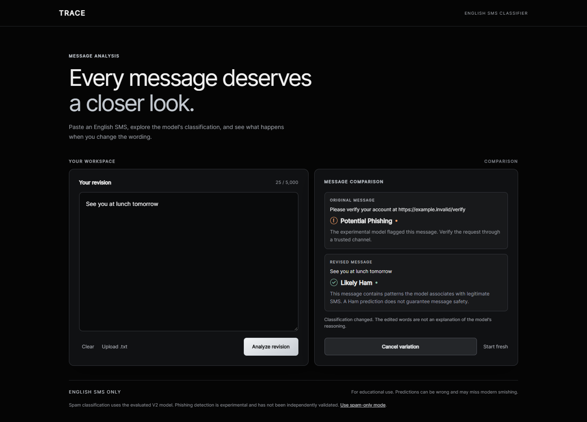
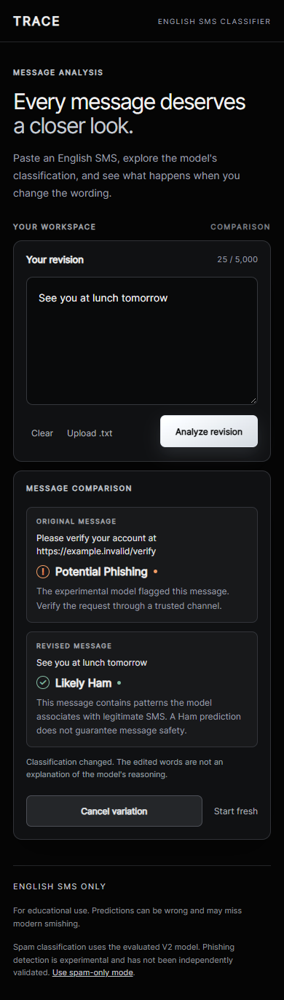

# TRACE V3 · English SMS Classifier

[Open the live TRACE demo](https://sms-spam-detection-nlp-xi.vercel.app/)

TRACE V3 is an educational English SMS classifier that lets you analyze a message and compare
its prediction with a revised version. It runs on Vercel with a static HTML, CSS, and JavaScript
frontend, a FastAPI backend, and a reproducible Python NLP pipeline.

The live demo combines the evaluated historical V2 spam classifier with an experimental phishing
classifier. Select **Use spam-only mode** to run V2 alone. See the [V3 model card](docs/MODEL_CARD.md#trace-v3-release-candidate).




## V3 outcomes

| Outcome | Meaning |
|---|---|
| **Likely Spam** | The message matches patterns associated with SMS spam. |
| **Likely Ham** | The message matches patterns associated with legitimate SMS. A Ham result does not guarantee message safety. |
| **Potential Phishing** | The experimental classifier flagged the message. Verify the request through a trusted channel. |
| **Inconclusive** | TRACE abstained and gives a reason, such as no letters, unsupported script, or no recognized features. |

Predictions can be wrong and may miss modern smishing. TRACE is for educational use.

## Evaluation

The table measures **V2 spam classification** on the historical SMS Spam Collection. Both the
original recipe and V2 used the same group-aware evaluation protocol. The locked test contains
1,031 messages from the same corpus and era, including 128 spam messages. See the
[full evaluation report](docs/EVALUATION.md).

| Metric | Original recipe | V2 spam classifier |
|---|---|---|
| Spam F1, 15-fold group CV (development) | 0.861 ± 0.044 | **0.949 ± 0.014** |
| Spam recall, CV | 0.761 | **0.913** |
| Expected cost / message, CV (false alarm = 3× a miss) | 0.0312 | **0.0149** (−52%) |
| Locked test: spam F1 [95% CI] | 0.914 [0.874, 0.948] | **0.980** [0.961, 0.996] |
| Locked test: missed spam / false alarms (of 128 / 903) | 17 / 4 | **5 / 0** |
| Locked test: PR-AUC | 0.959 | **0.994** |

**V3 phishing detection has no independent performance estimate.** Its development data
strongly confounds the dataset source with the label, so those scores cannot establish
effectiveness on real-world SMS. See the [V3 development report](docs/V3_DEVELOPMENT.md)
and [source audit](docs/V3_SOURCE_AUDIT.md).

## How it works

The V2 spam classifier uses the following pipeline. V3 adds a separate lightweight classifier
for the experimental phishing verdict. FastAPI serves both checksummed JSON model artifacts
without scikit-learn, NumPy, or pickle in the runtime.

```
text ─► abstain? (no letters / non-Latin / no known word) ─► normalize (NFKC, lowercase, mask URLs
     and numbers as zzurl / zzphone / zzcode / zznum) ─► word 1–2-grams + char 2–5-grams, TF-IDF
     ─► linear SVM score ─► Platt calibration ─► P(spam) ≥ 0.75 ? spam : ham
```

* **One preprocessing implementation** shared by training and serving ([ADR 0003](docs/adr/0003-preprocessing.md)).
* **Group-aware evaluation:** exact and near-duplicate campaigns never straddle a split ([ADR 0001](docs/adr/0001-evaluation-protocol.md)).
* **Model selection by expected cost** with a pre-registered one-standard-error rule over 11 candidates ([ADR 0002](docs/adr/0002-model-selection.md)).
* **Pickle-free, checksummed JSON artifact** executed by ~475 lines of standard-library Python, verified against scikit-learn to 6e-15 ([ADR 0004](docs/adr/0004-pickle-free-artifact.md)).
* **Explicit abstention** with machine-readable reasons ([ADR 0005](docs/adr/0005-abstention.md)).

Architecture and module map: [docs/ARCHITECTURE.md](docs/ARCHITECTURE.md).

## Quick start (run the app)

Python 3.12. The repository bundles both release artifacts. Serving requires only the runtime
dependencies.

```powershell
python -m venv .venv
.\.venv\Scripts\Activate.ps1          # macOS/Linux: source .venv/bin/activate
python -m pip install -r requirements.txt
python -m uvicorn app.main:app --host 127.0.0.1 --port 8000
```

Open <http://127.0.0.1:8000/>. API docs at `/docs`.

```powershell
$message = @{ text = "Congratulations! You won a free prize. Call now to claim." } | ConvertTo-Json
Invoke-RestMethod http://127.0.0.1:8000/predict/v3 -Method Post -ContentType application/json -Body $message
```

| Endpoint | Purpose |
|---|---|
| `POST /predict` | V2 spam-only classification for 1–5,000 Unicode code points |
| `POST /predict/v3` | V3 classification with an additional experimental phishing outcome |
| `GET /health` · `GET /ready` | Liveness · readiness (verified model loaded) |
| `GET /model` | Version, threshold, limits, evaluation summary and caveats |
| `GET /model/v3` | Experimental model version, both artifact checksums and validation status |

Full contract, error codes, and the frontend handoff: [docs/API.md](docs/API.md).

## Train, evaluate, reproduce

```powershell
python -m pip install -r requirements-dev.txt
# download spam.csv into data/ (instructions and checksum: docs/DATASET.md)
python scripts/prepare_nltk.py                 # only to reproduce the v1 baseline
python -m spam_detector data                   # repair, dedupe, group, split -> reports/data/
python -m spam_detector audit-legacy           # quantify the original protocol's leakage
python -m spam_detector experiment             # 11 candidates x 15 group-CV folds -> reports/experiments/
python -m spam_detector reproduce              # rebuild models/spam-v2 and compare sha256
python -m spam_detector explain "Free entry! Txt WIN to 87121"
```

All parameters live in [`configs/pipeline.toml`](configs/pipeline.toml). `release` never overwrites
an artifact, and `evaluate` (locked test set) requires an explicit flag and logs every run.
The [V3 development guide](docs/V3_DEVELOPMENT.md) documents the pinned source snapshots,
experimental benchmarks, and artifact reproduction commands.

## Tests

```powershell
python -m pytest --cov=spam_detector --cov=app          # dataset-gated tests skip without data/spam.csv
python -m ruff check .
npm --prefix tests/browser ci
npm --prefix tests/browser exec -- playwright install chromium
npm --prefix tests/browser test                          # browser regressions
```

Coverage includes featurizer parity with scikit-learn, export equivalence for LR/SVM/NB, artifact
tampering and incompatibility, leakage assertions, golden predictions (Unicode, emoji, other
scripts), the HTTP contract (413/422/503/500), privacy of logs, an import guard that keeps
scikit-learn out of the API process, and an end-to-end pipeline run on synthetic data.
CI (`.github/workflows/ci.yml`) runs lint and tests, an API smoke test with **only** the runtime
dependencies installed, and the Playwright suite.

## Deployment

The [v3.0.0 release](https://github.com/Nagy-API/sms-spam-detection-nlp/releases/tag/v3.0.0)
runs on Vercel as one Python function serving both the frontend and API. The
[deployment runbook](docs/DEPLOYMENT.md) covers hosted verification and rollback.

## Documentation

| Document | What it covers |
|---|---|
| [LEARNING_GUIDE.md](docs/LEARNING_GUIDE.md) | Every component explained, plus interview questions with answers |
| [EVALUATION.md](docs/EVALUATION.md) | Protocol, all results, error analysis, test-set access log |
| [MODEL_CARD.md](docs/MODEL_CARD.md) | Intended use, limits, biases, performance |
| [DATASET.md](docs/DATASET.md) | Provenance, license, acquisition, data-quality repairs |
| [ARCHITECTURE.md](docs/ARCHITECTURE.md) | System diagram, modules, request lifecycle, dependencies |
| [API.md](docs/API.md) | HTTP contract and frontend integration guide |
| [DEPLOYMENT.md](docs/DEPLOYMENT.md) | Vercel build, preview runbook, rollback |
| [docs/adr/](docs/adr/) | Six architecture decision records |

## Improvements over the original project

| Area | Before | After |
|---|---|---|
| Data | Truncated 50 messages, mojibake (`å£` for `£`), HTML entities, dataset-only `<#>` markers | Repaired and validated, with a fingerprinted dataset |
| Evaluation | One random split, near-duplicate leakage, model chosen on the test set | Group-aware repeated CV, locked and logged test set, bootstrap CIs |
| Preprocessing | Deleted digits, `£`, `!`, URLs. Notebook and API differed | One shared normalizer that keeps typed placeholders |
| Model | Count NB, uncalibrated, 0.5 threshold | Word+char TF-IDF SVM, Platt-calibrated, cost-derived threshold |
| Responsible output | Abstained only on zero features | Abstains on no letters, non-Latin script, or unknown words, with a reason |
| Artifact | Pickles tied to one scikit-learn version | Checksummed JSON, byte-for-byte reproducible, compatibility-checked |
| Serving | 207 MiB bundle, NLTK download at build | 20 MiB, FastAPI only, readiness/model endpoints, privacy-safe logs, body limits, CSP |
| Engineering | 8 API tests | Python and browser regression suites, CI, ADRs, model card |

## Dataset and license

The SMS Spam Collection (Almeida & Gómez Hidalgo, 2011) is distributed by UCI under CC BY 4.0
([doi:10.24432/C5CC84](https://doi.org/10.24432/C5CC84)). The Kaggle CSV used here is not
redistributed in this repository, see [docs/DATASET.md](docs/DATASET.md). The original v1 notebook
is kept in `notebook/` for history. Saved table previews containing dataset rows were removed
from the current notebook. Earlier revisions retain those outputs. Its metrics come from the v1
protocol and are superseded by [docs/EVALUATION.md](docs/EVALUATION.md). The legacy pickle
files are historical artifacts outside the deployed runtime. Only load a pickle from a trusted source.
