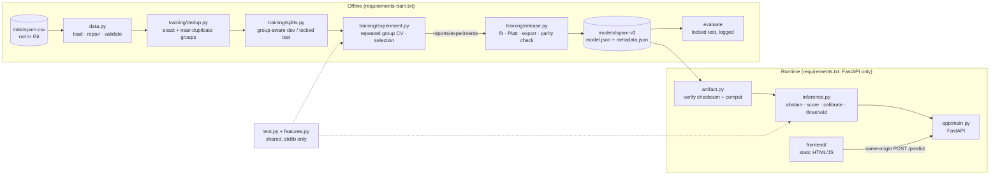

# Architecture

## System overview

The key design property: **one normalizer and one featurizer** (`text.py`, `features.py`) are
imported by both training and inference, so train/serve skew is impossible by construction. The
runtime side imports only the standard library plus FastAPI/Pydantic.
`tests/integration/test_runtime_and_release.py` fails if the API process ever imports scikit-learn,
NumPy, SciPy, NLTK, joblib, or `spam_detector.training`.

## Repository layout

| Path | Responsibility |
|---|---|
| `spam_detector/text.py` | The only text normalization (NFKC, case, placeholder masking) and the letter/script profile |
| `spam_detector/features.py` | Word and char_wb n-grams, vocabulary, IDF, TF-IDF/count weighting, L2 norm (pure Python) |
| `spam_detector/artifact.py` | `model.json`/`metadata.json` schema, deterministic serialization, checksum and compatibility checks |
| `spam_detector/inference.py` | `SpamClassifier`: abstention → features → linear score → Platt → threshold, plus exact explanations |
| `spam_detector/data.py` | CSV loading, encoding repair, schema validation, dataset fingerprint |
| `spam_detector/training/dedup.py` | Canonical and template keys, Jaccard shingles, union-find grouping |
| `spam_detector/training/splits.py` | StratifiedGroupKFold dev/test split, CV folds, leakage assertions, fingerprint |
| `spam_detector/training/candidates.py` | Candidate specs, scikit-learn adapter, linear export of LR/SVM/NB, Platt fitting |
| `spam_detector/training/baseline.py` | The v1 NLTK recipe, reproduced verbatim |
| `spam_detector/training/metrics.py` | Metrics, ECE, Bayes threshold, bootstrap CIs |
| `spam_detector/training/experiment.py` | Data preparation, repeated CV with cross-fitted calibration, one-SE selection |
| `spam_detector/training/release.py` | Release build, parity assertion, locked-test evaluation with access log |
| `spam_detector/training/legacy_audit.py` | Reproduces the v1 split and quantifies its leakage |
| `spam_detector/cli.py` | `python -m spam_detector …` commands |
| `app/main.py` | FastAPI app factory, middleware (body limit, request ID, logs, headers), endpoints |
| `configs/pipeline.toml` | Every experiment and release parameter |
| `models/spam-v2/` | Released artifact (immutable) · `models/legacy-v1/`: preserved v1 pickles |
| `reports/` | Dataset, CV, legacy-audit, and test reports (generated, committed) |
| `tests/` | `unit/`, `integration/`, `golden/`, `browser/` (Playwright) |

## Request lifecycle

1. **Cold start** (once per serverless instance): the lifespan handler loads `model.json`
   (~3 MB) and checks its SHA-256 against `metadata.json`, the schema version, the preprocessing
   version, and array shapes. It takes 0.05–0.19 s. On failure the app still starts, and `/ready`
   and `/predict` return 503 with a reason in the logs.
2. **Request:** the body-size middleware rejects > 64 KiB → Pydantic validates `text` (1–5,000
   code points, non-blank) → `SpamClassifier.predict`:
   * no letters → `inconclusive/no_letters`; < 50% Latin letters → `inconclusive/unsupported_script`
   * `normalize` → word 1–2-grams and char 2–5-grams → sparse TF-IDF vector (out-of-vocabulary
     n-grams ignored); no known word → `inconclusive/no_recognized_features`
   * `score = w·x + b` → `p = 1/(1+e^-(a·score+b'))` → `spam` if `p ≥ 0.75`
3. **Response and log:** one JSON log line with request ID, path, status, duration, label, reason,
   and character count. Never the text.

## Design decisions

| ADR | Decision |
|---|---|
| [0001](adr/0001-evaluation-protocol.md) | Group-aware CV on development, locked and logged test set |
| [0002](adr/0002-model-selection.md) | Linear SVM, word + char n-grams, Platt, cost threshold 0.75 |
| [0003](adr/0003-preprocessing.md) | One signal-preserving normalizer, no NLTK |
| [0004](adr/0004-pickle-free-artifact.md) | JSON artifact + stdlib runtime (bundle 207 → 20 MiB) |
| [0005](adr/0005-abstention.md) | Explicit, versioned abstention reasons |
| [0006](adr/0006-no-transformer.md) | No transformer in this phase |

## Dependencies and why each exists

| Set | Packages | Why |
|---|---|---|
| Runtime (`requirements.txt`) | fastapi, starlette, pydantic(-core), anyio, uvicorn, and their pinned transitive deps | HTTP serving and validation only |
| Training (`requirements-train.txt`) | scikit-learn, SciPy, NumPy | Estimators, splitters, sparse matrices, metrics, reference implementations for parity tests |
| | nltk (+ regex, tqdm) | Only to reproduce the v1 baseline |
| | joblib | Only to load the preserved v1 pickles in the audit |
| Dev (`requirements-dev.txt`) | pytest, pytest-cov, ruff, httpx2 | Tests, coverage, lint, FastAPI TestClient |

No experiment-tracking server was added. Each experiment writes a versioned JSON report (config
hash, dataset hash, split fingerprint, Git commit, library versions, per-candidate metrics) that is
reviewed in pull requests. At this project's scale, that gives MLflow-style traceability without
running infrastructure.
